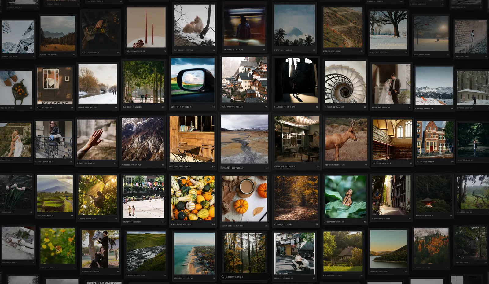

# Wallpaper App

An interactive wallpaper discovery experience built with React and Vite.
Browse Pexels' curated collection or search for a subject, explore photos in an
infinite fisheye-style grid, open a focused preview, and download the original
image.

[](https://sauravrwt.github.io/Wallpaper-App/)

<div align="center">
  
</div>

## Highlights

- Infinite, continuously recycled photo grid
- Debounced Pexels search with empty, loading, and error states
- One-hour curated-photo cache in `localStorage`
- Mouse, touch, wheel, and keyboard navigation
- Accessible photo dialogs and image download controls
- Responsive light and dark themes
- Reduced-motion support

## Tech Stack

- React 18
- Vite 7
- React Icons
- Vitest and Testing Library
- Pexels REST API

## Getting Started

### Prerequisites

- Node.js 20 or newer
- npm
- A Pexels API key from [Pexels API](https://www.pexels.com/api/)

### Installation

```bash
git clone https://github.com/SauRavRwT/Wallpaper-App.git
cd Wallpaper-App
npm install
```

Create a local environment file:

```bash
cp env.example .env
```

On Windows PowerShell:

```powershell
Copy-Item env.example .env
```

Replace the placeholder in `.env`:

```env
VITE_PEXELS_API_KEY=YOUR_PEXELS_API_KEY
```

Restart the dev server after changing environment variables.

### Development

```bash
npm run dev
```

Open [http://localhost:5173/Wallpaper-App/](http://localhost:5173/Wallpaper-App/) in your browser.

## Scripts

| Command | Description |
| --- | --- |
| `npm run dev` | Start the Vite development server |
| `npm run build` | Create an optimized production build in `dist/` |
| `npm run preview` | Preview the production build locally |
| `npm test` | Run the Vitest suite once |
| `npm run deploy` | Build and publish the app to GitHub Pages |

## Controls

- Drag or swipe to pan
- Scroll or use the trackpad to move through the gallery
- Use arrow keys to navigate
- Press Enter to open the centered photo
- Press Escape to close the photo dialog

## Project Structure

```text
src/
├── App.jsx                         # Pexels fetching and app state
├── App.css                         # Application theme
├── components/
│   └── FisheyeGrid/
│       ├── FisheyeInfiniteGrid.jsx # Interactive photo grid
│       └── FisheyeInfiniteGrid.css
└── index.jsx                       # React entry point
```

## Contributing

Contributions are welcome. For focused changes:

1. Fork the repository.
2. Create a feature branch.
3. Keep changes scoped and testable.
4. Run `npm test` and `npm run build`.
5. Open a pull request with a clear description.

## License

See [Pexels' API terms](https://www.pexels.com/license/) for image usage
requirements. This repository does not currently include an application license.
